<div align="center">

# SwarmBox

**A persistent Podman box for your AI coding agents —<br>operated from a Web Studio, your phone, or SSH.**

<p>
  <a href="https://github.com/feroult/swarmbox/releases/latest"></a>
  <a href="#security"></a>
  <a href="#security"></a>
  <a href="LICENSE"></a>
</p>

<p>
  <a href="#quick-start">Quick start</a> ·
  <a href="#agents--addons">Addons</a> ·
  <a href="#remote-access">Remote</a> ·
  <a href="#everyday-commands">Commands</a> ·
  <a href="#security">Security</a> ·
  <a href="#documentation">Docs</a>
</p>

<br>



</div>

<br>

SwarmBox gives **Claude Code**, **Antigravity (`agy`)**, **OpenCode**, and **OpenAI Codex** a single persistent rootless container (`~/swarmbox`) with `sudo`, nested Podman, and headless Chromium — keeping your host clean while agents run in parallel.

- **Multi-repo & Git worktrees:** agents group by repository, isolate automatically into `sb/wt-*` worktrees on branch collision, and survive restarts as zero-RAM parked cards.
- **One studio everywhere:** self-hosted Web Studio (desktop & phone) and 24-bit SSH Terminal Cockpit attach to the same live `herdr-core` sessions, with zero external CDN dependencies.
- **Autonomous Sysop & local voice:** optional `sysop` operator routes tasks across tabs with one-tap **Allow / Cancel** gates, paired with offline `whisper.cpp` voice dictation (`voice`).

---

## Quick start

Requires **Podman 4.3+** (Linux, WSL2 on the Linux filesystem, or macOS via a Podman machine).

```bash
curl -fsSL https://github.com/feroult/swarmbox/releases/latest/download/install.sh | sh -s -- --with claude
swarmbox          # pulls the image, creates the box, and opens the Terminal Cockpit (shortcut: sx)
claude            # inside the box: launches Claude Code in auto-approve mode
```

- **Web Studio:** run `swarmbox url` and open `http://127.0.0.1:7681`.
- **Other agents & keys:** pass `--with antigravity`, `--with opencode`, or `--with codex`, or forward a host key with `swarmbox env add ANTHROPIC_API_KEY && swarmbox reset`.

<br>

<p align="center">
  
</p>

---

## Agents & addons

Addons install on demand inside `~/swarmbox` and persist across image updates and resets:

```bash
swarmbox addon list
swarmbox addon install sysop      # autonomous operator, auto tab naming, approval cards
swarmbox addon install voice      # local whisper.cpp speech-to-text microphone
```

Available addons: **`claude`**, **`antigravity`** (`agy`), **`opencode`**, **`codex`**, **`sysop`**, **`voice`**, plus pinned runtimes **`go`**, **`gcloud`**, **`clasp`**, and **`poetry`**.

---

## Remote access

Reach your Web Studio, Sysop approvals, and voice mic over HTTPS using **Cloudflare Tunnel + Access** (free Zero Trust email code):

```bash
swarmbox remote setup --domain example.com --email you@example.com
swarmbox url
```

`cloudflared` runs in a separate container on your host, keeping tunnel secrets out of the box and exposing zero host ports ([docs/cloudflare.md](docs/cloudflare.md)).

---

## Everyday commands

```bash
swarmbox                              # start (if needed) and attach to the box
swarmbox --plain                      # plain bash shell without multiplexer
swarmbox url                          # show local and remote Web Studio URLs
swarmbox config list                  # show settings and their sources
swarmbox env add NAME                 # forward a host env var into the box
swarmbox addon list                   # list available and installed addons
swarmbox update                       # pull the latest image and refresh the CLI
swarmbox reset                        # recreate the box (keeps ~/swarmbox)
swarmbox stop                         # stop the box without deleting anything
```

---

## Security

SwarmBox runs in a rootless Podman container, which **shares the kernel** with your host and is not a VM boundary. It confines agent mistakes to `~/swarmbox`, keeps host Podman sockets and Cloudflare credentials outside the box, binds the web gateway to `127.0.0.1`, and sends zero telemetry. For untrusted code, run SwarmBox inside a VM ([docs/microvm.md](docs/microvm.md)). See [SECURITY.md](SECURITY.md).

---

## Documentation

Full guides live in `docs/`:

- **Studio & workflows:** [Web Studio](docs/web-terminal.md) · [Worktrees](docs/worktrees-design.md) · [Pinned sessions](docs/pins-design.md) · [Theme](docs/theme.md)
- **Operators & addons:** [Sysop](docs/sysop.md) · [Voice](docs/voice.md) · [Addons & Bus](docs/addons-design.md)
- **Infrastructure:** [Architecture](docs/design.md) · [Remote access](docs/cloudflare.md) · [Nested Podman](docs/nested-podman.md) · [MicroVM](docs/microvm.md) · [Uninstall](docs/uninstall.md)

[Changelog](CHANGELOG.md) · [Contributing](CONTRIBUTING.md) · [Security](SECURITY.md) · [Code of conduct](CODE_OF_CONDUCT.md) · [Third-party notices](THIRD_PARTY_NOTICES.md) · [Apache-2.0](LICENSE)
