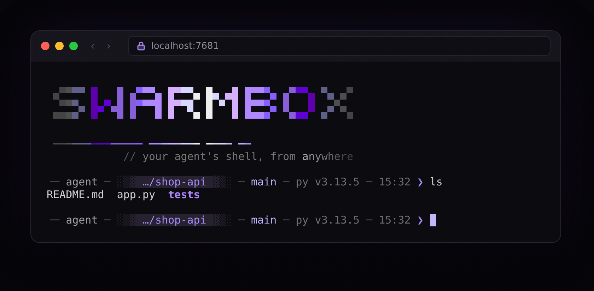

# SwarmBox

<p align="center"></p>

**A box where your AI agent works with freedom, and a shell you can reach from anywhere.**

Give your coding agent (Claude Code, Gemini CLI, OpenCode) a box of its own. Inside it the agent runs in auto-approve mode: it installs tools, builds and runs
containers, and gets on with the job without asking at every step. A mistake stays inside one folder of your machine. The box keeps running, and you step in from
any terminal tab or from a browser, on your machine or away from it, into the same shell and the same session.

- **Freedom to work.** No approval prompts. The agent installs tools, runs its own containers (nested Podman) and drives a browser (Chrome DevTools MCP is built in).
- **One session, from anywhere.** Every terminal tab and the browser join the same tmux session. Remote access goes through Cloudflare Tunnel and Access, with an e-mail code.
- **Contained.** Rootless Podman; the agent sees one workspace folder, not the rest of your machine (see [Security](#security)).
- **Persistent.** Projects, logins, the SSH key and installed tools live in the workspace folder, so you can delete and recreate the box and lose nothing.
- **A neutral image, tools on demand.** Claude Code, Gemini CLI, OpenCode, gcloud, clasp, Go and Poetry install the first time you use them.

## Quick start

About ten minutes, most of it the image download (1.75 GB). You need Linux, or Windows with WSL2. Docker is not supported; macOS through a Podman machine is unverified.

**1. Install Podman 4.3 or newer** (Debian 12/13, Ubuntu 24.04 or newer, WSL2 with one of them; Ubuntu 22.04 is too old). On WSL2 keep everything on the Linux filesystem, not `/mnt/c`.

```bash
sudo apt install podman uidmap       # Fedora: sudo dnf install podman
podman run --rm docker.io/library/alpine echo ok    # as your own user, not root
ls /dev/net/tun                      # must exist: the box runs Podman inside itself
```

**2. Install SwarmBox with Claude Code as the default agent.**

```bash
curl -fsSL https://github.com/feroult/swarmbox/releases/latest/download/install.sh | sh -s -- --with claude
```

It downloads the `swarmbox` script of the release, checks its sha256, writes it to `~/.local/bin/swarmbox` (and a short name, `sx`, unless one exists) and records the image and `claude`
in `~/.config/swarmbox/config`. It edits no startup file; if `~/.local/bin` is not in your `PATH` it says how to add it. No `curl`? `podman run --rm ghcr.io/feroult/swarmbox:2.0.0 install --with claude | sh`.

**3. Open the box, and run Claude Code.**

```bash
swarmbox          # the first time: pulls the image, creates the box, opens a shell (you are the user agent)
claude            # inside the box: installs Claude Code on first use, asks you to log in, runs in auto-approve mode
```

Your home in the box is the workspace folder `~/swarmbox` of your machine, and the login lives there, so it survives `swarmbox reset`. To use an API key instead:

```bash
export ANTHROPIC_API_KEY=sk-ant-...  # in the terminal where you run swarmbox, not inside the box
swarmbox env add ANTHROPIC_API_KEY
swarmbox reset                       # keys are passed when the box is created; the workspace is kept
```

Prefer a scoped key: the agent can read every variable you pass in.

**4. Come back from anywhere.** Run `swarmbox` in a second tab and you join the same session. `swarmbox url` prints the address of the web terminal (`http://127.0.0.1:7681`), which shows the same tabs.
`swarmbox pubkey` prints the box's SSH key; add it as a deploy key to let the agent push to a repository.

If something stops: `swarmbox up` exits 3 when Podman is older than 4.3 or `/dev/net/tun` is missing, and 4 when the workspace is on a Windows drive or not writable. To remove SwarmBox, see [docs/uninstall.md](docs/uninstall.md).

## Everyday commands

```bash
swarmbox                    # create the box if needed, then open a shell in it
swarmbox help               # list the commands
swarmbox claude             # run a command in the box from your machine
swarmbox url                # print the address of the web terminal
swarmbox stop               # stop the box; nothing is deleted
swarmbox reset              # recreate the box so a changed setting applies; the workspace is kept
swarmbox update             # fetch a newer image and refresh the swarmbox command from it
swarmbox env add NAME       # pass one of your variables into the box
swarmbox config list        # show the settings
swarmbox tool list          # show the tools you can install
swarmbox remote setup       # set up remote access with Cloudflare
```

In the browser, `Alt+1..9` (`Option` on a Mac) switches window and `Alt+N` opens one; in a terminal the tmux prefix is `Ctrl+A` (`Ctrl+A d` detaches and leaves everything running). Details in [docs/web-terminal.md](docs/web-terminal.md).

## Remote access

Everything in the box keeps running while you are away, and every way in lands in the same tmux session.

**A browser, from any device (Cloudflare Tunnel and Access).** No router port and no public IP: Cloudflare asks for an e-mail code before it shows the terminal. You need a free Cloudflare account and a domain on it.
On your machine (not in the box), with an API token whose permissions are listed in [docs/cloudflare.md](docs/cloudflare.md):

```bash
export CLOUDFLARE_API_TOKEN=...      # or leave it out and paste it when asked
swarmbox remote setup --domain example.com --email you@example.com
swarmbox url                         # prints the local and the public address
```

Say yes when `setup` offers to store the tunnel token (or paste the output of `swarmbox remote token` into `swarmbox config set CLOUDFLARE_TUNNEL_TOKEN`), so a single `swarmbox up` brings the address back after a reboot.
`swarmbox remote status` checks it and `swarmbox remote off` removes the hostname, the login and the connector. Whoever passes the login has the same control as the agent: list only your own e-mail.

**A terminal, over SSH.** If you can SSH to the machine that runs the box: `ssh you@your-machine`, then `swarmbox`. Closing the connection leaves the session running.

## Security

SwarmBox is rootless Podman, and it is **not complete isolation**: like any container it shares the kernel with your machine and has the known limits of that model.
For a stronger boundary run it inside a virtual machine, a microVM or a dedicated machine ([docs/microvm.md](docs/microvm.md)).

- **The box gives you:** a rootless container (even root inside is an unprivileged user of your machine), one workspace folder visible to the agent, no host Podman socket, a web terminal on `127.0.0.1` only, Cloudflare credentials kept outside the box, and a box you can delete and recreate.
- **The agent can:** change or delete everything in the workspace, use `sudo` in the box, reach the network, read every token you pass in and use the SSH key, and keep running while you are away.

Nested Podman and remote access trade some isolation for capability. Pass scoped tokens, use a deploy key per repository, review changes with `git diff`, and do not expose the web port yourself.
More in [SECURITY.md](SECURITY.md) and [docs/design.md](docs/design.md).

## Status

SwarmBox 2 is stable. The image is built, scanned, signed and tested in CI on Linux (amd64 and arm64), and the `swarmbox` script is tested under macOS's `/bin/sh` with a fake Podman.
Not verified on real machines: macOS with a Podman machine, WSL with real Windows drives, Podman older than 4.3, a host user other than UID 1000 and the real Cloudflare setup end to end.
`swarmbox update` fetches the newest image of the current series; `swarmbox update --to 2.0.0` pins a version.

## Privacy

SwarmBox sends **no telemetry**. It makes no network call of its own except to pull the image, to install a tool you asked for, to check for a tool update, and, with `swarmbox remote`, to reach Cloudflare.
Logs stay on your machine, under `<workspace>/.local/state/swarmbox/` (and `~/.local/state/swarmbox/` on the host).

## Documentation

- [docs/web-terminal.md](docs/web-terminal.md): the browser terminal
- [docs/theme.md](docs/theme.md): the purple glow, the palette of every part, and schemes for Windows Terminal, Ghostty and Claude Code
- [docs/cloudflare.md](docs/cloudflare.md): remote access with Cloudflare Tunnel and Access
- [docs/nested-podman.md](docs/nested-podman.md): containers inside the box
- [docs/uninstall.md](docs/uninstall.md): remove SwarmBox
- [docs/microvm.md](docs/microvm.md): stronger isolation with a VM or microVM
- [docs/design.md](docs/design.md) and [docs/security-review.md](docs/security-review.md): architecture and the review of the host script
- [SECURITY.md](SECURITY.md), [CHANGELOG.md](CHANGELOG.md), [THIRD_PARTY_NOTICES.md](THIRD_PARTY_NOTICES.md)

## Contributing and license

Contributions are welcome: read [CONTRIBUTING.md](CONTRIBUTING.md) and the [CODE_OF_CONDUCT.md](CODE_OF_CONDUCT.md). SwarmBox is licensed under Apache-2.0, see [LICENSE](LICENSE).
