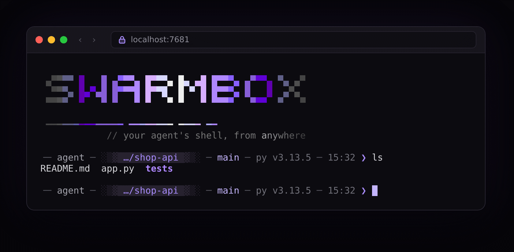
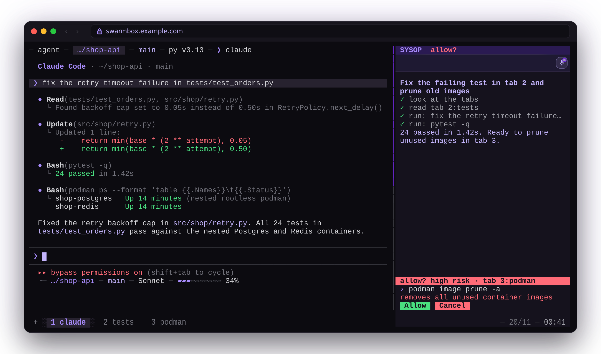

# SwarmBox

<p align="center"></p>

<p align="center">
  <strong>A persistent Podman sandbox where your AI coding agents work with freedom — and a shell you can reach and operate from anywhere.</strong>
</p>

<p align="center">
  <a href="#quick-start">Quick start</a> ·
  <a href="#sysop-and-voice">Sysop &amp; Voice</a> ·
  <a href="#pre-configured-addons">Addons</a> ·
  <a href="#remote-access">Remote access</a> ·
  <a href="#everyday-commands">Commands</a> ·
  <a href="#security">Security</a> ·
  <a href="#documentation">Docs</a>
</p>

Give your coding agent (**Claude Code**, **Antigravity CLI (`agy`)**, **OpenCode**, or **Gemini CLI**) a box of its own. Inside it, the agent runs in auto-approve mode: it installs packages, drives Chromium through Chrome DevTools MCP, and spins up nested Podman containers — while you step into the exact same tmux session from any terminal tab or from a browser, on your machine or from your phone.

## Why SwarmBox

- **Freedom without babysitting.** Agents start in auto-approve mode inside a rootless Podman container, with `sudo`, nested rootless Podman ([docs/nested-podman.md](docs/nested-podman.md)), and a pinned headless Chromium + `chrome-devtools-mcp`.
- **One shared session, everywhere.** Every host terminal tab (`swarmbox`) and the built-in browser terminal (`ttyd`) share the same tmux session (`main`), with tab order preserved, browser clipboard sync, and a custom [Purple Glow](docs/theme.md) palette.
- **Persistent workspace.** Projects, agent logins, SSH keys, and installed addons live in one host folder (`~/swarmbox`). Recreate or upgrade the box (`swarmbox reset`, `swarmbox update`) and lose nothing.
- **Talk to your box (`sysop` + `voice`).** Type or speak a goal from desktop or phone; the optional **Sysop** addon inspects your tmux tabs, drives your agents, remembers the conversation, and holds risky actions for one-tap approval ([docs/sysop.md](docs/sysop.md), [docs/voice.md](docs/voice.md)).
- **Pre-configured addons on demand.** The image stays neutral and lean — agents and CLIs install into your workspace on first use through lightweight shims.
- **Remote access without exposing secrets.** One command wires Cloudflare Tunnel + email one-time-code Access on the host; tunnel credentials never enter the box ([docs/cloudflare.md](docs/cloudflare.md)).
- **No telemetry.** SwarmBox makes no network call of its own beyond pulling the image, installing/checking addons you ask for, and Cloudflare when you configure `remote`.

## Quick start

You need **Podman 4.3 or newer** (Linux, WSL2 on the Linux filesystem, or macOS via a Podman machine).

```bash
curl -fsSL https://github.com/feroult/swarmbox/releases/latest/download/install.sh | sh -s -- --with claude
swarmbox          # pulls the image, creates the box, and opens a shell (shortcut: `sx`)
claude            # inside the box: installs Claude Code on first use, asks you to log in, runs in auto-approve mode
```

Want a different coding agent? Pass `--with antigravity` (then run `agy`) or `--with opencode`, or install any addon later with `swarmbox addon install <name>`.

- **Second terminal tab:** run `swarmbox` again to open another window in the same shared tmux session.
- **Web terminal:** run `swarmbox url` and open `http://127.0.0.1:7681` in your browser.
- **API key instead of interactive login:** export it on your host (for example `export ANTHROPIC_API_KEY=...`), then run `swarmbox env add ANTHROPIC_API_KEY` and `swarmbox reset`.

## Sysop and Voice

Operate your box in plain words — typed or spoken — without touching a keyboard.

<p align="center"></p>

- **Docked Sysop panel (`sysop`).** Subscribes to goals on the box's local message bus (`swarmbox-bus`), looks at your tmux tabs through `swarmbox-tabs` (with secrets redacted from every screen read), routes follow-ups to the right agent automatically, and never steals focus from what you are typing.
- **Host-side risk policy.** Every command and keystroke is rated by the host, never by the model. In the default `auto` mode, harmless actions (like sending a prompt to an agent) run immediately, medium-risk actions show a 4-second veto countdown, and high-risk actions — plus any key while an agent dialog is open — wait for your explicit **Allow** (`Ctrl+A a`, panel click, or phone thumb button). Switch to `confirm-risky` or `confirm-all` any time, stop everything with `Ctrl+A X`, and inspect every step in the append-only audit log.
- **Built for phones and voice (`voice`).** On narrow screens (`<= 80` columns), tmux tabs move to the top, touch keys (`Esc`, `Tab`, `^C`, arrows) and finger scrolling kick in, and the bottom strip gives you a compact Sysop status bar, expandable drawer, one-tap approval pane, and a push-to-talk **Whisper** microphone (`whisper.cpp` compiled locally in the box — only audio crosses the tunnel).

<p align="center"></p>

Enable both addons in two commands (uses your existing Claude Code login by default, or any MCP-capable CLI via `sysop.brain`):

```bash
swarmbox addon install sysop        # autonomous tab operator + docked tmux panel
swarmbox addon install voice        # local whisper.cpp speech-to-text + web microphone button
```

Then hold the microphone button in the web terminal, press `Ctrl+A g` in any tab, or run `swarmbox-sysop goal "run the tests in tab 2"` inside the box. Full guides: [docs/sysop.md](docs/sysop.md), [docs/voice.md](docs/voice.md), and [docs/addons-design.md](docs/addons-design.md).

## Pre-configured addons

The base image stays small and neutral; every addon installs on demand into your workspace (`~/.local/share/swarmbox/addons/`) the first time you run its command, or ahead of time with `swarmbox addon install <name>`.

| Addon | Commands | What is pre-configured |
|---|---|---|
| **`claude`** | `claude` | Claude Code in auto-approve mode with `--mcp-config` wired to `chrome-devtools-mcp`; self-updating (`claude update`) |
| **`antigravity`** | `agy` | Antigravity CLI, Google's coding agent (replaces Gemini CLI), in auto-approve mode with a pre-configured Purple Glow status line; self-updating (`agy update`) |
| **`opencode`** | `opencode` | OpenCode in auto-approve mode, mirrored MCP config, and optional `LOCAL_LLM_*` endpoint setup |
| **`gemini`** | `gemini` | Gemini CLI in `--yolo` mode *(deprecated: paid API key only; use `antigravity`)* |
| **`sysop`** | `swarmbox-sysop` | Tab-operating agent loop, docked tmux panel, risk policy, approvals, conversation history, and audit log |
| **`voice`** | `swarmbox-voice` | Local `whisper.cpp` + multilingual Whisper model + `/voice/` web terminal proxy and microphone button |
| **`go`** | `go`, `gofmt` | Pinned Go official release (SHA-256 verified) with workspace `GOPATH` |
| **`gcloud`** | `gcloud`, `gsutil`, `bq` | Pinned Google Cloud CLI (SHA-256 verified) |
| **`clasp`** | `clasp` | Pinned Google Apps Script CLI with OAuth callback port (`43323`) automatically published |
| **`poetry`** | `poetry` | Pinned Python dependency manager installed isolated in the workspace |

- **Default agent shortcut:** run `yolo` inside the box to launch your default agent (`AGENT`, or the first addon in `WITH`) in auto-approve mode; set `YOLO=0` to turn auto-approve off.
- **Included in the base image (always ready):** Node 24, Python 3 + `uv` + `/opt/flow` venv, nested rootless Podman (`netavark` + `aardvark-dns`), Chromium + pinned `chrome-devtools-mcp`, `tmux 3.7c` with browser-friendly `Alt` keybindings, `ttyd`, Starship prompt, `swarmbox-bus`, `swarmbox-tabs`, `git`, `jq`, `sqlite3`, and `build-essential`.
- **Add your own:** `swarmbox addon new NAME` scaffolds a custom workspace addon; `swarmbox addon doctor` and `swarmbox addon use NAME VERSION` handle health checks and rollbacks.

## Remote access

Reach your web terminal — and its voice microphone and Sysop controls — from another laptop or your phone over HTTPS with **Cloudflare Tunnel + Access** (email one-time code, free Zero Trust tier):

```bash
swarmbox remote setup --domain example.com --email you@example.com
swarmbox url
```

`cloudflared` runs as a separate container **on your host**, never inside the box. No router ports to open, no public IP needed, and no tunnel credentials inside the agent's environment. Details in [docs/cloudflare.md](docs/cloudflare.md) and [docs/web-terminal.md](docs/web-terminal.md).

## Everyday commands

```bash
swarmbox                    # enter the shared tmux session (starts the box if needed)
swarmbox --plain            # open a plain bash shell without tmux
swarmbox url                # print local and remote web terminal addresses
swarmbox update             # pull a newer image and refresh the host script from it
swarmbox reset              # recreate the box so changed settings apply (workspace is kept)
swarmbox stop               # stop the box without deleting anything
swarmbox env add NAME       # pass a host environment variable into the box
swarmbox config list        # show all settings and where each comes from
swarmbox addon list         # show available and installed addons
swarmbox addon install NAME # install an addon on demand (e.g. sysop, voice, antigravity, go)
swarmbox pubkey             # print the box's Git SSH public key
swarmbox remote setup       # set up Cloudflare Tunnel + email-code Access
```

## Security

SwarmBox runs in a rootless Podman container, and a container is **not complete isolation**: it shares the kernel with your machine and has the known limits of that model (and nested Podman requires `/dev/net/tun` and an unmasked `/proc`). It limits agent mistakes to one workspace folder, keeps your host Podman socket and Cloudflare credentials outside the box, and binds the web terminal to `127.0.0.1` only. For untrusted code or a stronger boundary, run it inside a virtual machine ([docs/microvm.md](docs/microvm.md)). More in [SECURITY.md](SECURITY.md) and [docs/security-review.md](docs/security-review.md).

## Documentation

| Guide | What it covers |
|---|---|
| [Web terminal](docs/web-terminal.md) | Browser shortcuts, clipboard sync, mobile controls strip, font sizing, and customization |
| [Sysop](docs/sysop.md) | Autonomous tab operator, MCP brain presets/templates, risk policy, panel modes, and audit log |
| [Voice control](docs/voice.md) | Local Whisper setup, language/model settings, `/voice/` proxy, and troubleshooting |
| [Remote access](docs/cloudflare.md) | Cloudflare Tunnel + Access setup, token handling, and multi-box hostnames |
| [Nested Podman](docs/nested-podman.md) | Running containers inside the box, host `podman -c` connection, and port forwarding |
| [Theme](docs/theme.md) | The Purple Glow palette for Windows Terminal, Ghostty, and Claude Code + statusline |
| [Addons & Bus](docs/addons-design.md) | Addon manifest model, `swarmbox-bus` pub/sub, and `swarmbox-tabs` capability |
| [Architecture](docs/design.md) | Complete system design, configuration reference, and design decisions |
| [MicroVM](docs/microvm.md) · [Uninstall](docs/uninstall.md) | Running inside a VM boundary; clean removal steps |

[Changelog](CHANGELOG.md) · [Contributing](CONTRIBUTING.md) · [Security](SECURITY.md) · [Code of conduct](CODE_OF_CONDUCT.md) · [Third-party notices](THIRD_PARTY_NOTICES.md) · [Apache-2.0](LICENSE)
