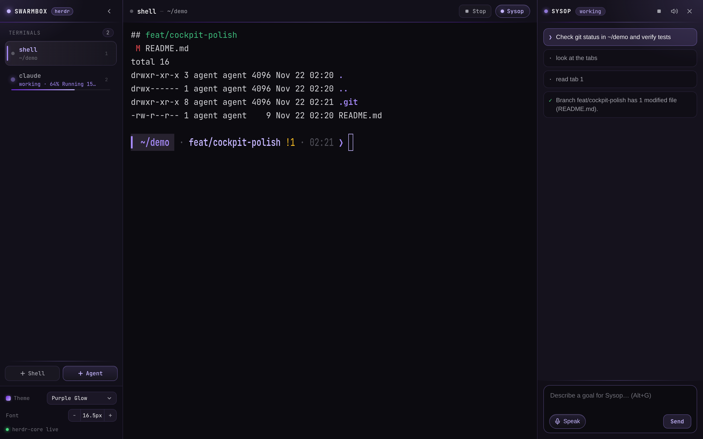
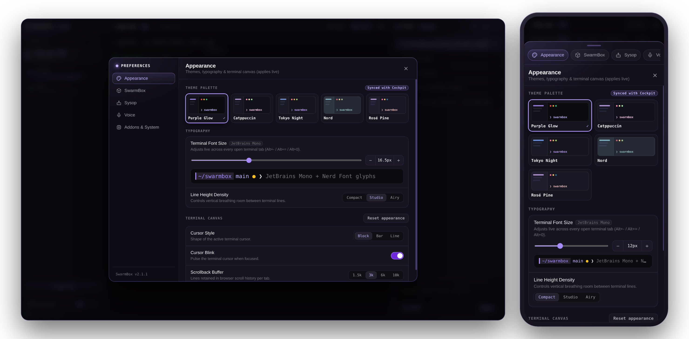
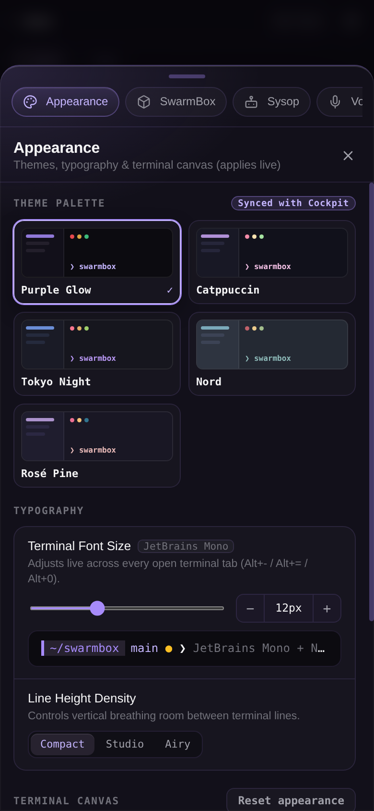

# SwarmBox

<p align="center">
  <strong>Give your AI coding agents a persistent Podman box of their own — and operate them from a native Web Studio, your phone, or SSH.</strong>
</p>

<p align="center">
  <a href="#quick-start">Quick start</a> ·
  <a href="#herdr-web-studio--mobile">Web Studio &amp; Mobile</a> ·
  <a href="#sysop--voice">Sysop &amp; Voice</a> ·
  <a href="#agents-addons--base-image">Addons</a> ·
  <a href="#remote-access">Remote access</a> ·
  <a href="#everyday-commands">Commands</a> ·
  <a href="#security">Security</a> ·
  <a href="#documentation">Docs</a>
</p>

<p align="center">
  
</p>

Run **Claude Code**, **Antigravity CLI (`agy`)**, **OpenCode**, or **Gemini CLI** in auto-approve mode inside a rootless Podman container with `sudo`, nested rootless Podman, and headless Chromium + `chrome-devtools-mcp`. Your projects, logins, SSH keys, and addons persist in one host folder (`~/swarmbox`) across resets and upgrades — with zero telemetry and instant access from desktop, browser, or phone.

## Quick start

Requires **Podman 4.3+** (Linux, WSL2 on the Linux filesystem, or macOS via a Podman machine).

```bash
curl -fsSL https://github.com/feroult/swarmbox/releases/latest/download/install.sh | sh -s -- --with claude
swarmbox          # pulls the image, creates the box, and opens a shell (shortcut: sx)
claude            # inside the box: installs Claude Code on first use and runs in auto-approve mode
```

- **Enable Herdr Web Studio & Terminal Cockpit:** `tmux` + `ttyd` is the default mux; opt into `herdr` any time with `swarmbox config set MUX herdr && swarmbox reset` (switch back with `MUX tmux`).
- **Open the Web UI or another tab:** run `swarmbox url` and visit `http://127.0.0.1:7681`, or run `swarmbox` again to open another window in the same live session.
- **Other agents or API keys:** pass `--with antigravity` (`agy`) or `--with opencode`, install later with `swarmbox addon install <name>`, or pass a host key with `export ANTHROPIC_API_KEY=...` then `swarmbox env add ANTHROPIC_API_KEY && swarmbox reset`.

## Herdr Web Studio & Mobile

Opt into `MUX=herdr` for a cohesive browser studio, phone interface, and 24-bit SSH Terminal Cockpit — all attached to the same live `herdr-core` session with zero extra host installs.

```bash
swarmbox config set MUX herdr
swarmbox reset
swarmbox          # opens the 3-pane Terminal Cockpit (SWARMBOX_HERDR_RAW=1 for raw attach)
```

<p align="center">
  
  &nbsp;
  
</p>

- **Studio Settings (`Alt+,`):** Desktop dialog with a 5-section rail and a responsive mobile bottom sheet with horizontal pills — **Appearance** (5 visual mini-terminal theme cards synced live with Terminal Cockpit, font-size slider/stepper, `Compact` / `Studio` / `Airy` line height, cursor style/blink, `1.5k`–`10k` scrollback), **SwarmBox**, **Sysop** (3-card autonomy policy + live browser TTS toggle), **Voice**, and **Addons & System** (one-click live addon install, configured MCP servers, Git SSH public key copy, shortcuts cheat sheet) — complete with a sticky host-apply bar (`swarmbox config set ... && swarmbox reset`) whenever host-managed keys change.
- **5 synchronized themes & bundled typography:** **Purple Glow** (default), Catppuccin Mocha, Tokyo Night, Nord, and Rosé Pine, paired with self-hosted **JetBrains Mono + Nerd Font** (zero CDN) and a redesigned Purple Glow Starship prompt.
- **Live OSC 7501 agent status:** Real-time working, blocked, and done status pills with inline progress bars in the sidebar, plus native `herdr-app` Agent Inbox integration for Sysop (`swarmbox.role=sysop`, automatically filtered out of your tab list).
- **Zero-friction terminal ergonomics:** Per-tab live `xterm.js` sessions with server-coalesced **zero-scroll hydration** (instant tab switching with preserved scrollback and floating "Jump to live" pill), **smart wrapped-line copy** (rejoins soft-wrapped and bordered agent commands while preserving multi-line scripts), **instant bracketed paste** (`Ctrl+V` / `Ctrl+Shift+V` via native `term.paste()` with zero double-paste or slow TUI redraws), and automatic WebSocket PTY recovery.
- **Mobile-first controls & keyboard parity:** iOS-calibrated momentum inertia touch scroll, compact touch-key strip (`Esc`, `Tab`, `^C`, arrows), pull-up Sysop drawer, and full desktop shortcuts (`Alt+1..9`, `Alt+N`, `Alt+,`, `Alt+B`, `Alt+S`, `Alt+G`, `Alt+T`, `Alt+-/=/0`).
- **Terminal Cockpit (`sx` / `swarmbox`):** 24-bit TrueColor 3-pane terminal UI mirroring the Web Studio over SSH — exact-width sidebar with OSC 7501 dots, inset PTY, right Sysop feed with `Ctrl+A g` Goal Composer, `Ctrl+A ?` shortcut modal, and SGR mouse support ([docs/herdr-cockpit-design.md](docs/herdr-cockpit-design.md), [docs/mux-architecture.md](docs/mux-architecture.md)).

## Sysop & Voice

Direct your box in plain words — typed or spoken — from desktop or phone, with host-enforced guardrails over anything risky.

<p align="center">
  
</p>

- **Autonomous tab operator (`sysop`):** Inspects your live tabs through `swarmbox-tabs` (secrets redacted from every screen read), remembers recent goals so follow-ups land cleanly, routes prompts to the right agent, and never steals focus from what you are typing.
- **Host-side risk policy:** Every command and keystroke is rated outside the model. In default `auto` mode, safe actions run immediately, medium-risk actions show a 4-second veto countdown, and high-risk actions — plus any key while an agent dialog is open — wait for your explicit **Allow** (`Ctrl+A a`, panel click, or mobile thumb button). Switch to `confirm-risky` or `confirm-all` any time, halt everything with `Ctrl+A X`, and review every step in the append-only audit log.
- **Local Whisper voice (`voice`):** `whisper.cpp` runs locally inside the box (only audio crosses the tunnel), powering the push-to-talk microphone across desktop and mobile.

```bash
swarmbox addon install sysop        # autonomous tab operator + docked panel
swarmbox addon install voice        # local whisper.cpp speech-to-text + web mic
```

Hold the microphone button in the Web UI, press `Alt+G` / `Ctrl+A g`, or run `swarmbox-sysop goal "run the tests in tab 2"`. Full guides: [docs/sysop.md](docs/sysop.md) and [docs/voice.md](docs/voice.md).

## Agents, Addons & Base Image

The base image stays lean and neutral; every addon installs on demand into your workspace (`~/.local/share/swarmbox/addons/`) on first command or via `swarmbox addon install <name>` (or one-click in Web Studio Settings).

| Addon | Commands | What is pre-configured |
|---|---|---|
| **`claude`** | `claude` | Claude Code in auto-approve mode wired to `chrome-devtools-mcp`; self-updating (`claude update`) |
| **`antigravity`** | `agy` | Antigravity CLI (Google's coding agent, successor to Gemini CLI) in auto-approve mode with Purple Glow status line; self-updating (`agy update`) |
| **`opencode`** | `opencode` | OpenCode in auto-approve mode, mirrored MCP config, and optional `LOCAL_LLM_*` endpoint setup |
| **`gemini`** | `gemini` | Gemini CLI in `--yolo` mode *(deprecated: paid API key only; use `antigravity`)* |
| **`sysop`** | `swarmbox-sysop` | Tab-operating agent loop, docked panel, host risk policy, approvals, memory, and audit log |
| **`voice`** | `swarmbox-voice` | Local `whisper.cpp` + multilingual Whisper model + `/voice/` proxy and microphone button |
| **`go`** | `go`, `gofmt` | Pinned official Go release (SHA-256 verified) with workspace `GOPATH` |
| **`gcloud`** | `gcloud`, `gsutil`, `bq` | Pinned Google Cloud CLI (SHA-256 verified) |
| **`clasp`** | `clasp` | Pinned Google Apps Script CLI with OAuth callback port (`43323`) published |
| **`poetry`** | `poetry` | Pinned Python dependency manager installed isolated in the workspace |

- **Default agent shortcut & custom addons:** run `yolo` inside the box to launch your default agent (`YOLO=0` disables auto-approve); scaffold workspace addons with `swarmbox addon new NAME`, check health with `swarmbox addon doctor`, and roll back with `swarmbox addon use NAME VERSION`.
- **Always ready in the base image:** Node 24, Python 3 + `uv`, nested rootless Podman (`netavark` + `aardvark-dns`, [docs/nested-podman.md](docs/nested-podman.md)), pinned headless Chromium + `chrome-devtools-mcp`, both mux backends (`tmux 3.7c` + `ttyd` default; `herdr-core` + Herdr Web Studio & Terminal Cockpit opt-in), Starship prompt, `swarmbox-bus`, `swarmbox-tabs`, `git`, `jq`, `sqlite3`, and `build-essential`.

## Remote access

Reach the Web Studio, Sysop approvals, and Whisper microphone from anywhere over HTTPS with **Cloudflare Tunnel + Access** (email one-time code, free Zero Trust tier):

```bash
swarmbox remote setup --domain example.com --email you@example.com
swarmbox url
```

`cloudflared` runs in a separate container **on your host**, never inside the box — no open router ports, no public IP, and no tunnel secrets inside the agent's environment ([docs/cloudflare.md](docs/cloudflare.md), [docs/web-terminal.md](docs/web-terminal.md)).

## Everyday commands

```bash
swarmbox                        # attach to the shared session (starts the box if needed)
swarmbox --plain                # open a plain bash shell without a multiplexer
swarmbox url                    # print local and remote web terminal addresses
swarmbox config list            # show all settings and where each comes from
swarmbox config set MUX herdr   # switch to the Herdr Web Studio & Terminal Cockpit backend
swarmbox env add NAME           # pass a host environment variable into the box
swarmbox addon list             # show available and installed addons
swarmbox addon install NAME     # install an addon (e.g. sysop, voice, antigravity, go)
swarmbox update                 # pull a newer image and refresh the host script from it
swarmbox reset                  # recreate the box so changed settings apply (workspace kept)
swarmbox stop                   # stop the box without deleting anything
swarmbox pubkey                 # print the box's Git SSH public key
swarmbox remote setup           # set up Cloudflare Tunnel + email-code Access
```

## Security

SwarmBox runs in a rootless Podman container, which is **not complete isolation**: it shares the kernel with your host and carries the known limits of containers (and nested Podman requires `/dev/net/tun` and an unmasked `/proc`). It confines agent mistakes to one workspace folder (`~/swarmbox`), keeps your host Podman socket and Cloudflare credentials outside the box, binds the web gateway to `127.0.0.1`, and makes no telemetry calls. For untrusted code or a stronger boundary, run SwarmBox inside a virtual machine ([docs/microvm.md](docs/microvm.md)). More in [SECURITY.md](SECURITY.md) and [docs/security-review.md](docs/security-review.md).

## Documentation

| Guide | What it covers |
|---|---|
| [Web terminal](docs/web-terminal.md) | Browser shortcuts, clipboard sync, mobile controls strip, font sizing, and customization |
| [Herdr & Cockpit](docs/herdr-cockpit-design.md) · [Mux architecture](docs/mux-architecture.md) | Opt-in `herdr` backend, Terminal Cockpit, Herdr Web Studio, and native OSC 7501 Sysop bridge |
| [Sysop](docs/sysop.md) | Autonomous tab operator, MCP brain presets/templates, risk policy, panel modes, and audit log |
| [Voice control](docs/voice.md) | Local Whisper setup, language/model settings, `/voice/` proxy, and troubleshooting |
| [Remote access](docs/cloudflare.md) | Cloudflare Tunnel + Access setup, token handling, and multi-box hostnames |
| [Nested Podman](docs/nested-podman.md) | Running containers inside the box, host `podman -c` connection, and port forwarding |
| [Theme](docs/theme.md) | The Purple Glow palette for Windows Terminal, Ghostty, and Claude Code + statusline |
| [Addons & Bus](docs/addons-design.md) | Addon manifest model, `swarmbox-bus` pub/sub, and `swarmbox-tabs` capability |
| [Architecture](docs/design.md) | Complete system design, configuration reference, and design decisions |
| [MicroVM](docs/microvm.md) · [Uninstall](docs/uninstall.md) | Running inside a VM boundary; clean removal steps |

[Changelog](CHANGELOG.md) · [Contributing](CONTRIBUTING.md) · [Security](SECURITY.md) · [Code of conduct](CODE_OF_CONDUCT.md) · [Third-party notices](THIRD_PARTY_NOTICES.md) · [Apache-2.0](LICENSE)
