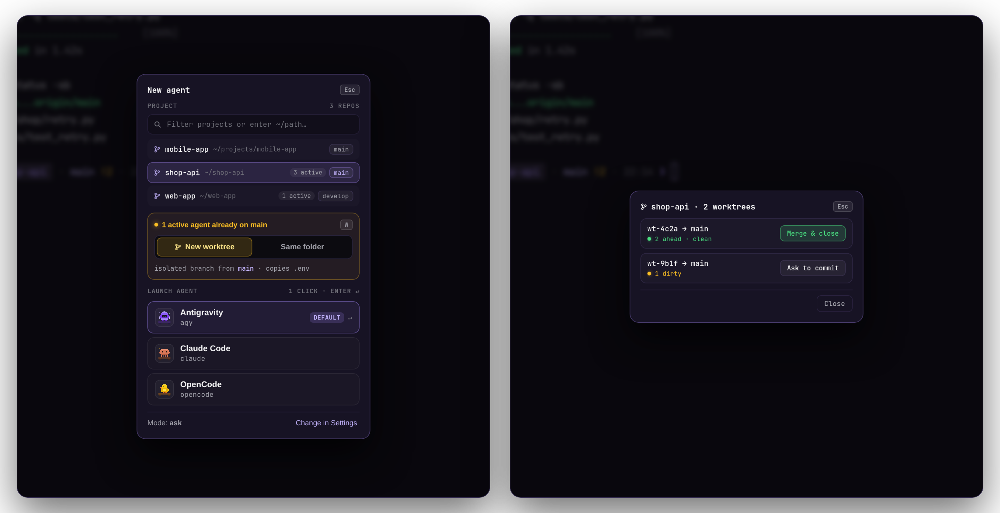
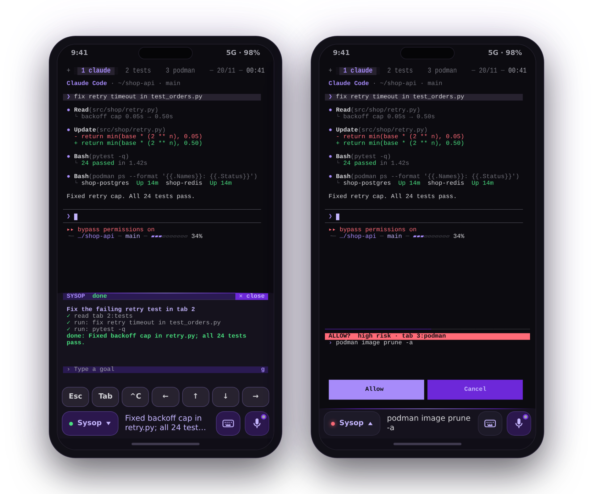

<div align="center">

# SwarmBox

**Give your AI coding agents a persistent Podman box of their own —<br>operated from a native Web Studio, your phone, or SSH.**

<p>
  <a href="https://github.com/feroult/swarmbox/releases/latest"></a>
  <a href="#security"></a>
  <a href="#security"></a>
  <a href="LICENSE"></a>
</p>

<p>
  <a href="#quick-start">Quick start</a> ·
  <a href="#multi-repo--git-worktrees">Worktrees</a> ·
  <a href="#web-studio--settings">Web Studio</a> ·
  <a href="#mobile-sysop--voice">Mobile &amp; Sysop</a> ·
  <a href="#agents--addons">Addons</a> ·
  <a href="#remote-access">Remote</a> ·
  <a href="#everyday-commands">Commands</a> ·
  <a href="#security">Security</a>
</p>

<br>


</div>

<br>

| Persistent Sandbox | Multi-Repo Studio &amp; Worktrees | Autonomous Sysop &amp; Local Voice |
| :--- | :--- | :--- |
| Run **Claude Code**, **Antigravity (`agy`)**, or **OpenCode** in auto-approve mode with `sudo`, nested Podman, and headless Chromium — with projects, logins, and SSH keys persisted in `~/swarmbox`. | Agents group automatically by Git repository, isolate into clean **Git worktrees** on collision, survive restarts as zero-RAM **parked cards**, and switch in `0 ms` with zero reflow. | Direct agents by text or voice from desktop or phone. **Sysop** inspects your box state, routes goals across tabs, and gates risky actions behind one-tap **Allow / Cancel** cards — backed by local `whisper.cpp`. |

---

## Quick start

Requires **Podman 4.3+** (Linux, WSL2 on the Linux filesystem, or macOS via a Podman machine).

```bash
curl -fsSL https://github.com/feroult/swarmbox/releases/latest/download/install.sh | sh -s -- --with claude
swarmbox          # pulls the image, creates the box, and opens the Terminal Cockpit (shortcut: sx)
claude            # inside the box: installs Claude Code on first use in auto-approve mode
```

- **Open the Web Studio:** run `swarmbox url` and visit `http://127.0.0.1:7681` — both the browser studio and SSH cockpit attach to the same live `herdr-core` terminals.
- **Other agents &amp; API keys:** pass `--with antigravity` (`agy`) or `--with opencode`, install later with `swarmbox addon install <name>`, or forward a host key via `export ANTHROPIC_API_KEY=...` and `swarmbox env add ANTHROPIC_API_KEY && swarmbox reset`.

---

## Multi-Repo & Git Worktrees

Run multiple agents on the same codebase in parallel without stepping on each other's files.

<p align="center">
  
</p>

- **Zero-friction launching (`Alt+A`):** Press `Alt+A` (or click **+ New agent**) to pick any auto-discovered Git repository in `~`, or click `+` on a repo header to spawn right beside your active agents.
- **Automatic worktree isolation:** Launching a second agent on an active branch detects the collision and isolates it into a fresh `sb/wt-*` worktree (copying `.env*` files automatically, configurable as `ask` / `auto` / `off`).
- **One-click reconcile &amp; persistent sessions:** Click a repo's `⑂ N` badge to dry-run merge checks and run **Merge &amp; close**, **Ask to commit**, or **Close &amp; clean**. Open agent sessions persist on their own: they survive `swarmbox stop` or `reset`, restarting on boot or waiting as zero-RAM `PARKED` cards with 1-click **Wake** ([docs/worktrees-design.md](docs/worktrees-design.md), [docs/pins-design.md](docs/pins-design.md)).

---

## Web Studio & Settings

One cohesive dark studio across desktop browser, phone, and 24-bit SSH Terminal Cockpit — bundled with zero external CDN dependencies.

<p align="center">
  
</p>

| Feature | Highlights |
| :--- | :--- |
| **Pixel-Art Agent Cards &amp; Focus Mode** | Live OSC 7501 badges (`IDLE`, `WORKING 74%`, `BLOCKED`, `DONE`), inline progress bars, `Alt+1..9` switching, inline rename (`Alt+R`), and distraction-free Focus Mode (`Alt+B`). |
| **Studio Settings (`Alt+,`)** | 5 live sections (**Appearance**, **SwarmBox**, **Sysop**, **Voice**, **Addons &amp; System**) with one-click addon installs, SSH public key copy, and a sticky host apply command bar. |
| **5 Synced Themes &amp; Offline Fonts** | **Purple Glow**, **Catppuccin**, **Tokyo Night**, **Nord**, and **Rosé Pine** synced across Web Studio and Cockpit, paired with self-hosted **JetBrains Mono + Nerd Font**. |
| **Smart Copy &amp; Clipboard Image Paste** | Rejoins soft-wrapped AI commands on copy, uses native Bracketed Paste for text, and uploads pasted or dropped screenshots (`Ctrl+V` / drag-and-drop) straight into the active agent. |

---

## Mobile, Sysop & Voice

Operate long-running agents from your phone with calibrated iOS touch scrolling, sticky tab controls, one-tap approvals, and offline Whisper dictation.

<p align="center">
  
</p>

```bash
swarmbox addon install sysop      # autonomous operator + approval cards + auto tab naming
swarmbox addon install voice      # local whisper.cpp speech-to-text microphone
```

- **Context-aware operator:** Sysop reads the unified box world model (`swarmbox state`), routes goals across tabs, auto-names unnamed sessions, and links agent tabs inline in its replies.
- **Configurable autonomy:** Runs immediately in `full-auto` (default), or switches to `auto`, `confirm-risky`, or `confirm-all` in **Settings → Sysop** to gate risky commands behind **Allow / Cancel**.
- **Private local voice:** Tap **Speak** on desktop or phone to record with a live waveform — transcribed locally via `whisper.cpp` without audio ever leaving your machine ([docs/sysop.md](docs/sysop.md), [docs/voice.md](docs/voice.md)).

---

## Agents & Addons

Addons install on demand inside your persistent workspace, keeping the base image lean while preserving versions across resets.

| Addon | Command | What it adds |
| :--- | :--- | :--- |
| **`claude`** | `claude` | Claude Code (auto-approve default) + Purple Glow statusline |
| **`antigravity`** | `agy` | Google Antigravity CLI (auto-approve default) + isolated statusline |
| **`opencode`** | `opencode` | Open-source terminal coding agent |
| **`sysop`** | `swarmbox-sysop` | Autonomous operator, auto tab naming, and approval cards |
| **`voice`** | `swarmbox-voice` | Local `whisper.cpp` speech-to-text web front |
| **`go`** · **`gcloud`** · **`clasp`** · **`poetry`** | `go`, `gcloud`, `clasp`, `poetry` | Pinned, SHA-256 verified developer runtimes &amp; CLIs |

> **Base image includes:** Node 24, Python 3 + `uv`, nested rootless Podman ([docs/nested-podman.md](docs/nested-podman.md)), headless Chromium + `chrome-devtools-mcp`, `herdr-core`, Starship prompt, `git`, `jq`, `sqlite3`, and `build-essential`. Run `yolo` inside the box to launch your default agent (`YOLO=0` disables auto-approve).

---

## Remote access

Reach your Web Studio, Sysop approvals, and Whisper mic from anywhere over HTTPS with **Cloudflare Tunnel + Access** (free Zero Trust email code):

```bash
swarmbox remote setup --domain example.com --email you@example.com
swarmbox url
```

`cloudflared` runs in a separate container **on your host**, never inside the box — zero open ports and no tunnel secrets inside the agent's environment ([docs/cloudflare.md](docs/cloudflare.md), [docs/web-terminal.md](docs/web-terminal.md)).

---

## Everyday commands

```bash
swarmbox                              # attach to the shared session (starts the box if needed)
swarmbox --plain                      # open a plain bash shell without a multiplexer
swarmbox url                          # print local and remote Web Studio addresses
swarmbox config list                  # show all settings and their sources
swarmbox config set WEB_PORT 7682     # change a setting (then swarmbox reset)
swarmbox config unset WEB_PORT        # revert a setting to its default
swarmbox config path                  # print the config file path
swarmbox env add NAME                 # forward a host environment variable into the box
swarmbox addon list                   # list available and installed addons
swarmbox addon install NAME           # install an addon (sysop, voice, antigravity, go, ...)
swarmbox update                       # pull the latest image and refresh the host script
swarmbox reset                        # recreate the box to apply settings (workspace kept)
swarmbox stop                         # stop the box without deleting anything
swarmbox pubkey                       # print the box's Git SSH public key
swarmbox remote setup                 # configure Cloudflare Tunnel + email-code Access
```

---

## Security

SwarmBox runs in a rootless Podman container, which is **not complete isolation**: it shares the kernel with your host and carries the known limits of containers (nested Podman requires `/dev/net/tun` and an unmasked `/proc`). It confines agent mistakes to one workspace folder (`~/swarmbox`), keeps your host Podman socket and Cloudflare credentials outside the box, binds the web gateway to `127.0.0.1`, and sends zero telemetry. For untrusted code or a stronger boundary, run SwarmBox inside a virtual machine ([docs/microvm.md](docs/microvm.md)). See [SECURITY.md](SECURITY.md) and [docs/security-review.md](docs/security-review.md).

---

## Documentation

| Guide | Covers |
| :--- | :--- |
| [Web terminal](docs/web-terminal.md) · [Herdr &amp; Cockpit](docs/herdr-cockpit-design.md) | Browser shortcuts, clipboard &amp; image paste, mobile dock, and Terminal Cockpit |
| [Worktrees](docs/worktrees-design.md) · [Pinned sessions](docs/pins-design.md) | Multi-agent Git worktree isolation, reconciliation, and persistent parked sessions |
| [Sysop](docs/sysop.md) · [Voice](docs/voice.md) | Autonomous operator, world model, autonomy policies, and local Whisper setup |
| [Remote access](docs/cloudflare.md) · [Nested Podman](docs/nested-podman.md) | Cloudflare Tunnel + Access, containers inside the box, and port forwarding |
| [Theme](docs/theme.md) · [Addons &amp; Bus](docs/addons-design.md) | Purple Glow palette, custom addons, `swarmbox-bus`, and `swarmbox-tabs` |
| [Architecture](docs/design.md) · [MicroVM](docs/microvm.md) · [Uninstall](docs/uninstall.md) | Full system design, VM boundary guide, and clean removal steps |

[Changelog](CHANGELOG.md) · [Contributing](CONTRIBUTING.md) · [Security](SECURITY.md) · [Code of conduct](CODE_OF_CONDUCT.md) · [Third-party notices](THIRD_PARTY_NOTICES.md) · [Apache-2.0](LICENSE)
